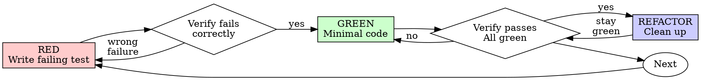

# Test-Driven Development (TDD)

## Overview

Write the test first. Watch it fail. Write minimal code to pass.

**Core principle:** If you didn't watch the test fail, you don't know if it tests the right thing.

**Violating the letter of the rules is violating the spirit of the rules.**

## When to Use

**Always:**
- New features
- Bug fixes
- Refactoring
- Behavior changes

**Exceptions (ask your human partner):**
- Throwaway prototypes
- Generated code

Thinking "skip TDD just this once"? Stop. That's rationalization.

## The Iron Law

```
NO PRODUCTION CODE WITHOUT A FAILING TEST FIRST
```

Write code before the test? Delete it. Start over.

**No exceptions:**
- Don't keep it as "reference"
- Don't "adapt" it while writing tests
- Don't look at it
- Delete means delete

Implement fresh from tests. Period.

## Red-Green-Refactor



### RED - Write Failing Test

Write one minimal test showing what should happen.

<Good>
```typescript
test('retries failed operations 3 times', async () => {
  let attempts = 0;
  const operation = () => {
    attempts++;
    if (attempts < 3) throw new Error('fail');
    return 'success';
  };

  const result = await retryOperation(operation);

  expect(result).toBe('success');
  expect(attempts).toBe(3);
});
```
Clear name, tests real behavior, one thing
</Good>

<Bad>
```typescript
test('retry works', async () => {
  const mock = jest.fn()
    .mockRejectedValueOnce(new Error())
    .mockRejectedValueOnce(new Error())
    .mockResolvedValueOnce('success');
  await retryOperation(mock);
  expect(mock).toHaveBeenCalledTimes(3);
});
```
Vague name, tests mock not code
</Bad>

**Requirements:**
- One behavior
- Clear name
- Real code (no mocks unless unavoidable)

### Verify RED - Watch It Fail

**MANDATORY. Never skip.**

```bash
npm test path/to/test.test.ts
```

Confirm:
- Test fails (not errors)
- Failure message is expected
- Fails because feature missing (not typos)

**Test passes?** You're testing existing behavior. Fix test.

**Test errors?** Fix error, re-run until it fails correctly.

### GREEN - Minimal Code

Write simplest code to pass the test.

<Good>
```typescript
async function retryOperation<T>(fn: () => Promise<T>): Promise<T> {
  for (let i = 0; i < 3; i++) {
    try {
      return await fn();
    } catch (e) {
      if (i === 2) throw e;
    }
  }
  throw new Error('unreachable');
}
```
Just enough to pass
</Good>

<Bad>
```typescript
async function retryOperation<T>(
  fn: () => Promise<T>,
  options?: {
    maxRetries?: number;
    backoff?: 'linear' | 'exponential';
    onRetry?: (attempt: number) => void;
  }
): Promise<T> {
  // YAGNI
}
```
Over-engineered
</Bad>

Don't add features, refactor other code, or "improve" beyond the test.

### Verify GREEN - Watch It Pass

**MANDATORY.**

```bash
npm test path/to/test.test.ts
```

Confirm:
- Test passes
- Other tests still pass
- Output pristine (no errors, warnings)

**Test fails?** Fix code, not test.

**Other tests fail?** Fix now.

### REFACTOR - Clean Up

After green only:
- Remove duplication
- Improve names
- Extract helpers

Keep tests green. Don't add behavior.

### Repeat

Next failing test for next feature.

## Good Tests

| Quality | Good | Bad |
|---------|------|-----|
| **Minimal** | One thing. "and" in name? Split it. | `test('validates email and domain and whitespace')` |
| **Clear** | Name describes behavior | `test('test1')` |
| **Shows intent** | Demonstrates desired API | Obscures what code should do |

When writing or changing any test, read the rules that keep tests honest in [writing-good-tests.md](writing-good-tests.md):
- Name the production change that would make the test fail — before writing it
- Assert on real behavior, never on mock behavior
- Keep test-only code in test utilities, out of production classes
- Understand a dependency's side effects before mocking it

## Cover the plan, not the universe

Write the plan's cases and no others: every branch, error path, validation rule and guard the plan names gets one test, and you test it once, at the layer that owns it. A layer above tests wiring only: one success path and one error passed up from below. Do not prove a lower layer's cases again.

Test through the seam the plan names, or with none named the public interface callers use, never private code. Inputs that share one code path go in one table-driven test, one row each. One test, then its code, then the next. Never write all the tests before any code.

Adversarial inputs go only where the input crosses a trust boundary: user input, files, network, auth, money, migrations, deletes. There the plan names which adversarial inputs to try, and you write the ones it names. The kinds to pick from: empty, null, 0, negative, huge, unicode, off-by-one on both sides, wildcard and escape characters, a value from the wrong domain.

A bug fix gets a regression test that reproduces the exact bug and fails before the fix. A test for a path the plan does not cover is a note for a later plan, not work now.

## Quality bar

- A test that stays green with the implementation reverted is not a test. Check that it goes red.
- Assert effects, not mocks. Mock only the collaborator the change touches. Cover the flag-off path of every flag the change adds.
- Test tooling (fixtures, probes, cleanup helpers) exists to test the deliverable. It gets the minimum that works and no review rounds of its own.
- "Obvious", "one-liner" and "just config" are not exemptions.

## Rationalizations - STOP and Start Over

Each of these means: delete the code, start over with a test first.

- Code before the test, or "tests after reach the same goal". Tests written after pass at once and prove nothing. You never watched them fail.
- Skipping the red run, a test that passes at once, or a failure you cannot explain.
- "Too simple", "just this once", "I already tested it by hand", "I will add tests later". Manual checks cannot be re-run.
- "Keep it as reference" or "adapt it". That is testing after. Delete means delete.
- "Deleting X hours of work is wasteful". Sunk cost. Code you cannot trust is the waste.
- "Need to explore first". Fine. Throw the exploration away, then start with the test.
- "Hard to test" means the design is unclear. Simplify the interface.
- "Existing code has no tests". Test the behavior you change. The rest is a note for a later plan.
- "TDD slows me down" or "this is different". Skipping it means debugging later, which is slower.

## When Stuck

| Problem | Solution |
|---------|----------|
| Don't know how to test | Write wished-for API. Write assertion first. Ask your human partner. |
| Test too complicated | Design too complicated. Simplify interface. |
| Must mock everything | Code too coupled. Use dependency injection. |
| Test setup huge | Extract helpers. Still complex? Simplify design. |

## Debugging Integration

Bug found? Write failing test reproducing it. Follow TDD cycle. Test proves fix and prevents regression.

Never fix bugs without a test.
No exceptions without your human partner's permission.
